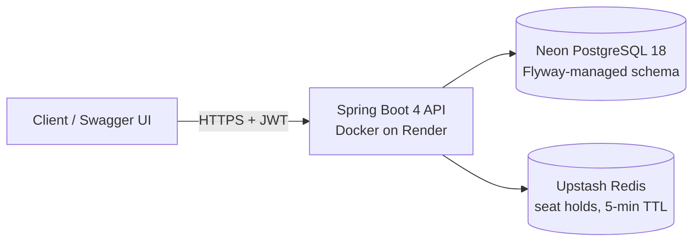
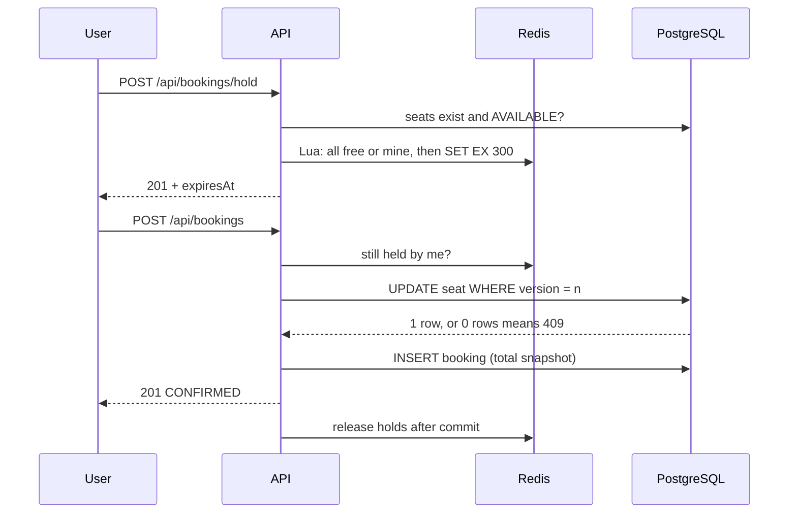
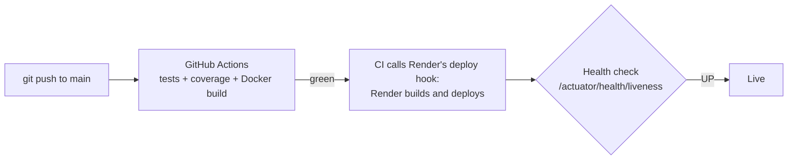

# BookMySeat 🎟️

[](https://github.com/Abhishek360007/BookMySeat/actions/workflows/ci.yml)


**Movie ticket booking API that guarantees one booking per seat under concurrent load.**

### 🚀 [Live demo: Swagger UI](https://bookmyseat-8j1e.onrender.com/swagger-ui/index.html)

> Free tier: the first load after a quiet period can take **about 2 minutes** while the app wakes up (if the first page shows an error, refresh it). After that it responds in about a second.

**Demo login** (role `USER`): `demo@bookmyseat.dev` / `DemoPass123`. Call `POST /api/auth/login`, copy the `accessToken`, click **Authorize**, then hold and book seats on the "Dune: Part Three" show. Please don't use a real password if you register your own account.

## Highlights

- **Redis seat holds with Lua:** selected seats are held for 5 minutes by one atomic script. Either every seat is held or none is, holds expire on their own, and this works across multiple app instances.
- **Optimistic locking (`@Version`):** the database is the final guard. When two confirms race for a seat, exactly one commit wins.
- **Proven with a 50-thread test:** Testcontainers tests fire 50 concurrent requests at one seat against real PostgreSQL and Redis, and CI runs them on every push.
- **Flyway-managed schema:** versioned SQL migrations, with Hibernate set to `validate`. CHECK constraints protect prices and totals in the database itself.
- **Hardened auth:** 15-minute JWT access tokens, rotating refresh tokens with stolen-token (reuse) detection, BCrypt passwords, `USER` / `ADMIN` roles, and per-IP rate limits on login and registration. Errors are RFC 9457 `ProblemDetail` responses.
- **Safe retries:** `Idempotency-Key` on booking confirmation, so a client that times out and retries gets the same booking back instead of an error or a duplicate.
- **Price snapshots and a cancellation cutoff:** a booking stores its total at booking time, and cancelling closes 2 hours before the show.
- **Production-ready extras:** paginated admin reports, Actuator health and business metrics, a request id on every response and log line, JSON logs in production, and a layered, non-root Docker image with a CDS archive that halves cold-start time.

## Architecture



## Booking flow



## Concurrency proof

Measured by the Testcontainers tests in this repo: 50 threads are released at the same instant by a `CountDownLatch`.

| Scenario | Result |
|---|---|
| 50 users **hold** the same seat | **1** succeeds, 49 get `409` |
| 50 users **confirm** the same seat (holds mocked as valid) | `ok=1`, `lockLost=49`: exactly **1** booking |
| Same booking race **without `@Version`** | **50 bookings for one seat** (the test fails, as it should) |

## Performance

Measured with [k6](https://k6.io) against the production Docker image (`prod` profile, connection pool of 5) on one machine (12 CPUs). Scripts are in [`load-tests/`](load-tests).

**Browsing** (50 virtual users searching, opening a show and loading its seat map for 55 s):

| Setup | Throughput | p95 search | p95 show | p95 seat map | Errors |
|---|---|---|---|---|---|
| Local database | ~1,250 req/s | 60 ms | 59 ms | 62 ms | 0 |
| Database with 20 ms latency, **no cache** | 82 req/s | 608 ms | 626 ms | 625 ms | 0 |
| Database with 20 ms latency, **Redis cache** | **214 req/s** | **4 ms** | **4 ms** | 675 ms | 0 |

The 20 ms of latency is added with [Toxiproxy](https://github.com/Shopify/toxiproxy) to mimic a managed database across the network (like Render → Neon). It shows the real bottleneck: each request holds one of only 5 pooled connections for several round trips, so requests queue. Caching shows and search results in Redis takes those requests off the database entirely. The seat map is deliberately not cached (it shows live holds), so it is now the remaining bottleneck.

**Ticket-release rush** (300 users each grab 2 random seats of the same 50, all at once, via hold → confirm):

| Result | Value |
|---|---|
| Confirmed bookings | 23 (46 seats) |
| Rejected at the hold step (`409`) | 277 |
| Seats sold twice | **0** (checked through the API and directly in the database) |
| Unexpected responses / server errors | 0 |

Run them yourself (app running on port 8080; raise the rate limits for the rush, since all virtual users share one IP):

```powershell
docker run --rm -v "${PWD}/load-tests:/scripts" -e BASE_URL=http://host.docker.internal:8080 `
  -e ADMIN_EMAIL=<admin> -e ADMIN_PASSWORD=<password> grafana/k6:2.3.0 run /scripts/browse.js
```

**Caching rules:** single shows are cached for 10 minutes and search results for 60 seconds. Any admin change to a show or venue clears the affected entries before the response returns (writes are synchronous: Lettuce would otherwise clear them in the background and a read straight after an edit could see old data, which a test caught). The cache is checked before a transaction starts, so a hit never borrows a database connection.

## Design decisions

**Redis for holds, PostgreSQL for bookings.** Holds are short-lived, so Redis expires them with no cleanup job, and a Lua script makes "check all seats, then hold all" a single atomic step. Confirmed bookings are permanent records, so they live in PostgreSQL, the source of truth.

**Price is snapshotted.** `totalAmount = price × seats` is computed on the server when the booking is confirmed and is never recalculated. If an admin changes a show's price, past bookings keep what the customer actually paid, and the client can never send its own amount.

**`BigDecimal` for money.** In `double`, `0.1 + 0.2` is `0.30000000000000004`. Money is `BigDecimal` in Java and `NUMERIC(10,2)` in the database, and the API rejects more than 2 decimal places.

**Flyway with `ddl-auto=validate`.** The schema changes only through reviewed, versioned SQL files (`V1__init.sql`, `V2__...`). Hibernate checks on startup that the entities match the schema, and a migration that was edited after it ran fails its checksum check.

**Rotating refresh tokens.** Access tokens live 15 minutes, so a leaked one expires quickly. Refresh tokens are random 256-bit values stored only as SHA-256 hashes (a database leak reveals no usable tokens). Each refresh revokes the old token and issues a new one in the same "family"; if a revoked token is ever presented again, it was copied, so the whole family is revoked and both the thief and the user must log in again. A row lock stops two concurrent refreshes from both succeeding.

**Rate limiting in Redis.** A fixed-window counter per IP (one atomic Lua `INCR` + `EXPIRE`) is shared by all app instances. Over the limit, the API answers `429` with `Retry-After`. If Redis is down, the limiter fails open after a 2-second timeout, so an outage never locks everyone out of logging in.

**Request ids.** Every response carries `X-Request-Id`, every log line of that request includes it, and every error body has a `requestId` field, so a user's error report leads straight to the matching logs. A caller's own id is reused only if it is short and harmless (`[A-Za-z0-9._-]{1,64}`), which blocks log injection.

**Idempotency keys.** Confirming a booking with an `Idempotency-Key` header stores `pending` in Redis (`SET NX`, 60 s), then `done` + the booking id for 24 hours after the database commit. A retry with the same key and seats returns the original booking (`Idempotent-Replayed: true`); the same key with different seats is `422`; a duplicate that arrives while the first is still running is `409`. If the booking fails, the key is released so the client can retry. Measured: 5 parallel requests with one key give 1 × `201` and 4 × `409`, and exactly one booking.

**Scheduled jobs with ShedLock.** Expired refresh tokens are deleted by a background job (revoked-but-unexpired ones are kept, so reuse detection still works). ShedLock takes a row lock in Postgres first, so with several instances only one runs it. Because Render sleeps when idle, it runs 5 minutes after each wake-up and then every 6 hours rather than at a fixed time.

**Injectable `Clock`.** Time rules ("cancellation closes 120 minutes before start", "no booking after the show has started") read `Instant.now(clock)`. Unit tests use a fixed clock to cover the exact boundaries: 1 second before the cutoff, exactly at it, and 1 second after it.

**The `Asia/Calcutta` timezone bug.** On an Indian Windows machine the JVM's default zone is the legacy ID `Asia/Calcutta`. The PostgreSQL driver sends that zone to the server, and the PostgreSQL 18 test container rejected it with `invalid value for parameter "TimeZone"`. The app pins the JVM to UTC in `main()`, and Maven Surefire passes `-Duser.timezone=UTC` because tests don't run `main()`.

## API

Interactive docs: `/swagger-ui.html` (use **Authorize** to paste a JWT).

| Method | Path | Auth | Purpose |
|---|---|---|---|
| POST | `/api/auth/register` | Public | Create an account (always role `USER`; 5 per hour per IP) |
| POST | `/api/auth/login` | Public | Get a 15-minute access token and a 7-day refresh token (5 attempts per minute per IP) |
| POST | `/api/auth/refresh` | Public | Swap a refresh token for a new pair; the old refresh token stops working |
| POST | `/api/auth/logout` | Public | Revoke the session that a refresh token belongs to |
| GET | `/api/users/me` | User | Current user's profile |
| GET | `/api/venues`, `/api/venues/{id}` | Public | Browse venues |
| POST / PUT / DELETE | `/api/venues/**` | Admin | Manage venues |
| GET | `/api/shows?venueId=`, `/api/shows/{id}` | Public | Browse shows and their prices |
| GET | `/api/shows/search?city=&q=&from=&to=&page=&size=&sort=` | Public | Search upcoming shows by city, title text and date range (paginated, soonest first) |
| POST / PUT / DELETE | `/api/shows/**` | Admin | Manage shows |
| GET | `/api/shows/{showId}/seats` | Public | Seat map (`AVAILABLE` / `HELD` / `BOOKED`) |
| POST | `/api/shows/{showId}/seats` | Admin | Generate seats, e.g. 5 rows × 10 = A1–E10 |
| POST | `/api/bookings/hold` | User | Hold seats for 5 minutes |
| POST | `/api/bookings/hold/release` | User | Release your holds |
| POST | `/api/bookings` | User | Confirm held seats (total computed on the server); optional `Idempotency-Key` header for safe retries |
| POST | `/api/bookings/{id}/cancel` | User | Cancel, up to 2 hours before the show |
| GET | `/api/bookings/me` | User | Your bookings, newest first |
| GET | `/api/admin/shows/{showId}/bookings?status=&page=&size=&sort=` | Admin | Paginated bookings for a show (default `CONFIRMED`, newest first, max 100 per page) |
| GET | `/api/admin/shows/{showId}/summary` | Admin | Seats booked / held / available, confirmed bookings, revenue |

`401` means no valid token, and `403` means a valid token without the required role.

## Run locally

**Prerequisites:** Java 21 and Docker Desktop (running). Spring Boot starts PostgreSQL and Redis from `compose.yaml`, and Flyway creates the schema on first start.

```powershell
git clone https://github.com/Abhishek360007/BookMySeat.git
cd BookMySeat

# Optional: create an admin on startup (credentials never live in the repo)
$env:ADMIN_EMAIL="admin@bookmyseat.dev"
$env:ADMIN_PASSWORD="choose-a-strong-password"   # at least 12 characters

.\mvnw spring-boot:run        # macOS/Linux: ./mvnw spring-boot:run
```

Then open **http://localhost:8080/swagger-ui.html**.

| Variable | Purpose | Default |
|---|---|---|
| `JWT_SECRET` | HS256 signing key (at least 32 bytes) | Dev-only value. **Always set it in production.** |
| `ADMIN_EMAIL` / `ADMIN_PASSWORD` | Admin account created on startup | Not set (no admin is created) |

Hold duration and the cancellation cutoff are in [`application.properties`](src/main/resources/application.properties).

## Run with Docker

No Java needed: the app runs as a container next to PostgreSQL and Redis.

```powershell
copy .env.example .env      # then set ADMIN_EMAIL, ADMIN_PASSWORD and JWT_SECRET (.env is git-ignored)
docker compose --profile app up -d --build
```

Open **http://localhost:8080/swagger-ui.html**. To stop only the app container and keep the databases running, use `docker compose stop app`.

- **Multi-stage build:** the JDK and Maven exist only in the build stage; the runtime image has just the JRE.
- **Layered for caching:** dependencies are downloaded before the source is copied, and the jar is split into Spring Boot layers. A code change rebuilds only the small application layer (about 0.4 MB); a cached rebuild takes about 15 seconds.
- **Non-root:** the app runs as `uid=1001(app)`.
- **Profile-gated:** plain `docker compose up`, and Spring Boot's own Docker Compose support, still start only the databases.

## Monitoring

| Endpoint | Access | Shows |
|---|---|---|
| `/actuator/health` | Public | `UP` / `DOWN` only. Admins also see components: `db`, `redis`, disk. |
| `/actuator/health/liveness`, `/actuator/health/readiness` | Public | Probes for Kubernetes or a load balancer |
| `/actuator/info` | Public | Build artifact, version and time |
| `/actuator/metrics/{name}` | Admin | JVM, HTTP and the business metrics below |

| Metric | Tags | Counts |
|---|---|---|
| `bookings.confirmed` | none | Successful bookings |
| `bookings.cancelled` | none | Cancellations |
| `seat.holds` | `result` = `success` / `conflict` | Hold attempts, including lost hold races |
| `booking.conflicts` | `reason` = `hold_missing` / `already_booked` / `lock_lost` | Why confirms were rejected; `lock_lost` is an optimistic-lock race lost at commit |

| `rate_limit.rejected` | `endpoint` = `login` / `register` | Requests turned away with `429` |

Tags never contain user or seat ids, which keeps the number of distinct metrics small.

**Logs:** every request is logged once (`GET /api/shows/2 -> 200 in 15 ms`) with its request id; health probes are skipped. Locally the id appears in brackets; in production (`prod` profile) each line is a JSON object in Elastic Common Schema, with `requestId` as a field.

## Deployment

The live demo runs entirely on free tiers, all in Singapore (AWS ap-southeast-1) to keep latency low:

| Piece | Service | Notes |
|---|---|---|
| App | **Render** web service, built from this repo's `Dockerfile` | 512 MB RAM, 0.1 CPU; sleeps after 15 minutes without traffic |
| Database | **Neon** PostgreSQL 18 | Direct (non-pooled) connection over TLS; Flyway migrates it on startup |
| Holds | **Upstash** Redis | TLS (`rediss://`); the Lua hold/release scripts run unchanged |

**Continuous deployment:**



The last CI step calls Render's deploy hook (stored as the GitHub secret `RENDER_DEPLOY_HOOK_URL`), so only a commit whose tests, coverage and Docker build are all green reaches production.

**Configuration:** production settings live in the `prod` profile ([`application-prod.properties`](src/main/resources/application-prod.properties)) and come entirely from environment variables: `DB_URL`, `DB_USERNAME`, `DB_PASSWORD`, `REDIS_URL`, `JWT_SECRET`, `ADMIN_EMAIL`, `ADMIN_PASSWORD`. No secrets are in the repo, and production uses its own JWT secret.

**Faster cold starts with CDS:** the Docker build does a training run that starts the app and saves every loaded class into a Class Data Sharing archive (`app.jsa`). At 0.1 CPU, startup dropped from 175 s to 92 s (measured locally with the same 512 MB / 0.1 CPU limits), at the cost of 32 MB more to download. On Render, waking from sleep went from about 197 s to about 125 s.

**Small-instance tuning:** `JAVA_TOOL_OPTIONS=-XX:MaxRAMPercentage=60 -XX:+UseSerialGC -XX:TieredStopAtLevel=1 -Xss512k` keeps memory around 300 MB of the 512 MB limit (measured in a local container limited to 512 MB and 0.1 CPU) and suits a single slow CPU.

**Demo data:** [`scripts/seed-demo.ps1`](scripts/seed-demo.ps1) creates the venue, a far-future show with 50 seats, and the demo user. It is idempotent (safe to re-run), and the admin password is only ever passed as a parameter:

```powershell
.\scripts\seed-demo.ps1 -BaseUrl https://bookmyseat-8j1e.onrender.com -AdminEmail <admin> -AdminPassword '<admin password>'
```

## Tests

```powershell
.\mvnw test
```

| Kind | Test | Covers |
|---|---|---|
| HTTP (MockMvc + Testcontainers) | `BookingApiTest` | The real HTTP contract with real logins: 401/403/400/409 `problem+json` shapes, field names, and the full hold → confirm → list → cancel flow |
| HTTP (MockMvc + Testcontainers) | `AuthApiTest` | Refresh token rotation, reuse detection revoking the whole session, logout, and that only hashes are stored |
| HTTP (MockMvc + Testcontainers) | `RateLimitTest` | 429 + `Retry-After` after the limit, limits per IP, and separate login / register budgets |
| HTTP (MockMvc) | `RequestIdTest` | Generated and reused request ids, rejection of unsafe ids, and the id in error bodies and log lines |
| HTTP (MockMvc + Testcontainers) | `IdempotencyApiTest` | Same key replays the same booking (booked once), key reused for other seats → 422, failed request frees the key |
| HTTP (MockMvc + Testcontainers) | `ShowSearchApiTest` | City / text / date filters combined, LIKE wildcards treated as text, pagination, sorting, invalid input → 400 |
| Integration (Testcontainers) | `RefreshTokenCleanupJobTest` | Only expired tokens are deleted; a second run inside the lock window is skipped by ShedLock |
| HTTP (MockMvc) | `ApiDocsTest` | The OpenAPI document: tags, public endpoints without a lock, documented `Idempotency-Key` |
| Unit (JUnit + Mockito, milliseconds) | `BookingServiceTest` | Cancellation cutoff boundaries and the "show already started" rule, with a fixed `Clock` |
| Integration (Testcontainers) | `SeatHoldConcurrencyTest` | 50 concurrent holds on one seat in real Redis: exactly 1 wins |
| Integration (Testcontainers) | `BookingConcurrencyTest` | 50 concurrent confirms in real PostgreSQL: exactly 1 booking |
| Integration (Testcontainers) | `BookMySeatApplicationTests` | The app starts and Flyway migrations V1 and V2 apply to an empty database |

The integration tests need Docker and never touch your dev database. GitHub Actions runs all of them on every push, publishes a coverage table on the run's summary page (JaCoCo: **83% of lines, 71% of branches** across 37 tests), uploads the HTML coverage report, then builds the Docker image. Locally, `.\mvnw verify` writes the report to `target/site/jacoco/index.html`.

## Roadmap

- [x] **Week 1:** Venues and shows CRUD, validation, `ProblemDetail` errors, Swagger
- [x] **Week 2:** Registration, JWT login, role-based security
- [x] **Week 3:** Seat maps, Redis holds, confirm/cancel with optimistic locking, concurrency tests
- [x] **Week 4:** Flyway migrations, price snapshots, cancellation cutoff, GitHub Actions CI
- [x] **Week 5:** Admin reports with pagination, HTTP-level API tests, Actuator health and metrics, Docker image
- [x] **Week 6:** Production profile, Neon + Upstash + Render deployment, demo seed script
- [x] **Week 7:** Rate limiting, rotating refresh tokens, CDS for faster cold starts, request ids and JSON logs
- [x] **Week 8:** Idempotency keys, show search, scheduled cleanup with ShedLock, test coverage in CI, richer Swagger docs
- [x] **Week 9:** k6 load tests, a 300-user booking rush with zero double bookings, Redis read cache (p95 608 ms → 4 ms with a remote-like database), deploy from CI
- [ ] **Later:** email verification for new accounts, payment integration, and a faster seat map

## Author

**Abhishek Raj**: [GitHub @Abhishek360007](https://github.com/Abhishek360007)
